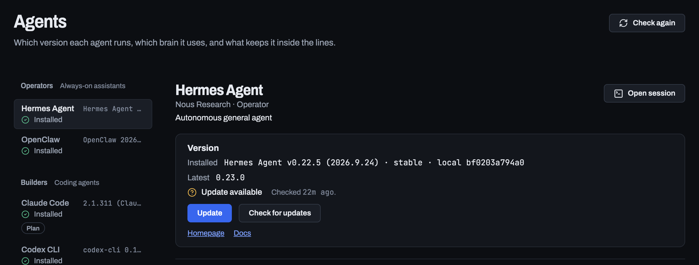

<h1 align="center">Agent OS</h1>

<p align="center">
  <strong>Agent OS is a desktop control room for AI agents: install, configure, launch, watch and stop Hermes Agent, OpenClaw, Claude Code, Codex and Cursor from one window, safely by default.</strong>
</p>

<p align="center">
  <a href="https://github.com/hharsha98/agent-os/releases/latest"></a>
  <a href="#run-from-source"></a>
  
</p>

<p align="center"><em>Version 0.4. Unsigned builds. Hand-tested on macOS (Apple silicon) only.</em></p>

![Agent OS Home page in a dark theme, version v0.4.0. An amber strip at the top says Claude Code in notes-app wants to use Write, that Agent OS never answers for you, and offers Open session. The headline says Claude Code is waiting for you. A ring diagram has an amber line lit to Claude Code, and a table lists Hermes Agent, OpenClaw, Claude Code, Codex CLI and Cursor Agent with their brains and status: Claude Code is Waiting for you, Hermes is Idle and the others are Ready. The top bar shows Level 1 Run agents, a Waiting for you (1) badge and a Hold to stop all button.](docs/screenshots/v2/home.png)

<sub>Home, recorded on the author's own Mac with Safety on "Look only", so nothing is running.</sub>

---

## Download

Get the installer for your computer from the [latest release](https://github.com/hharsha98/agent-os/releases/latest). The first public version, v0.3.0, came out on 1 October 2026.

Which file is yours:

| Your computer | Download |
| --- | --- |
| Mac with an Apple chip (M1, M2, M3, M4...), macOS 13.5 or newer | the `.dmg` with `aarch64` in its name |
| Mac with an Intel chip, macOS 13.5 or newer | the `.dmg` with `x64` in its name |
| Windows 10 or 11 | the `setup.exe` |
| Linux (Debian, Ubuntu and friends) | the `.deb` |
| Linux (anything else) | the `.AppImage` |

Not sure which Mac you have? Apple menu > About This Mac. "Chip" means Apple silicon. "Processor" means Intel.

### First launch (the builds are unsigned)

I have not paid for Apple or Microsoft developer certificates, so your computer will warn you the first time. The warning is expected.

- **macOS:** right-click the app, choose **Open**, then click **Open** again. On macOS 15 or newer it may still refuse. Then open **System Settings > Privacy & Security**, scroll down, and click **Open Anyway**.
- **Windows:** when SmartScreen says "Windows protected your PC", click **More info**, then **Run anyway**.
- **Linux:** an AppImage needs permission to run: `chmod +x Agent.OS_*.AppImage`, then double-click it or run it from a terminal.

**Check your download (optional).** Each release has a file called `SHA256SUMS.txt` next to the installers. It lists a fingerprint (a SHA-256 hash) for each installer. Save it in the same folder as your download, open a terminal there, and run the line for your system. The long string it prints must match your file's line in `SHA256SUMS.txt`, letter for letter.

- **Mac:** `shasum -a 256 "<the file you downloaded>"`
- **Linux:** `sha256sum "<the file you downloaded>"`
- **Windows (PowerShell):** `Get-FileHash ".\<the file you downloaded>" -Algorithm SHA256`

If they differ, delete the file and do not run it. To report a problem, see [SECURITY.md](SECURITY.md).

The first time it opens, Agent OS starts a small private server on your computer. You do not need to install Node or anything else first. The **Setup Assistant** checks your computer and offers to install the five agents. **Nothing is installed until you click for it.** (The desktop app does look up new agent versions by itself. See "Safety by default".)

---

## What it does

Agent OS has a sidebar with eight main pages: Home, Sessions, Agents, Runs, Team Room, Workspace, Setup and Safety. A collapsed **Labs** group holds older, experimental pages, including the dry-run Chat. The pages below are the ones built for the desktop app.

Version 0.4 has a new look (since 0.4.2 the Labs screens share it too): dark only, a cobalt-blue accent, a new logo (a ring with five dots), and fonts that ship inside the app so it looks the same offline. On a window about 1,366 px wide or less, the menu shrinks to icons. Press ⌘K (Ctrl+K on Windows and Linux) to search pages and actions.

### Sessions

A session is an agent's own terminal program running inside Agent OS. It is your installed copy of Claude Code, Codex, Cursor, Hermes or OpenClaw, so your keys and slash commands work the way they do in Terminal. Agent OS starts each program the way a normal terminal would, with your own sign-in and settings (if you picked an OpenRouter or Local brain for Claude Code or Codex in Agent OS, the session uses that brain). It never sets your home folder or the agents' config folders. For Claude Code it also passes its own small settings file (`--settings`): hooks that only tell Agent OS what Claude is doing, such as asking for permission, and a status-line wrapper for the Live meter that still runs your own status line. Your own Claude settings are not changed.


<sub>Sessions, on the author's Mac: a live Hermes Agent session in a throwaway demo folder, stopped right after this shot. Everything inside the terminal is Hermes's own output: its question about sharing usage counters, with "No thanks" already highlighted. Nothing was typed or answered. The tab and the side panel are Agent OS.</sub>

- **New session:** pick an agent and a folder. The folder can be any folder inside your home folder, but not the home folder itself and not Agent OS's own data folder. The desktop app has a folder picker, you can pick a recent folder, and in a browser tab you type the full path. Sessions need Safety level 1 ("Run agents"), and at most 8 can be open at once. When a live session already uses that folder and it is a git project, the dialog offers a separate copy (a second checkout of the project, a "git worktree", on a new branch named `agentos/<agent>-<n>`) or the same folder. OpenClaw never gets the offer.
- **Tabs:** one tab per session, named by its agent and folder. An ended session's tab says so, and you can dismiss it. The side panel shows the state (Starting, Live, Waiting for you, Idle, Held or Ended), the brain, how long the session has run, the Live meter (model, context used, plan used and cost so far, read from Claude Code's status line; a dash means unknown), Files changed, whether it is recorded, and a Stop button. Idle means nothing is running right now. Held means a plan limit paused it.
- **Alerts:** an agent that needs you gets an amber marker on its tab, a row in Home's "Waiting for you" strip and a badge in the top bar. In the desktop app you also get a desktop notification when the window is hidden or not in front (macOS asks permission once). In a browser tab a message shows at the bottom of the page. Agent OS only passes on the agent's own signal (a hook, a notification, a bell or an approval request, depending on the agent), so how good an alert is depends on the agent. Claude Code's alerts start after you trust the folder in Claude. Alerts for Hermes and Cursor are basic: Agent OS hears only a bell or a sign in the title, which may also mean the agent finished.
- **OpenClaw approval cards:** when OpenClaw asks to run a command, its card shows the command, with Allow once and Deny. The box holds up to 4,000 characters and scrolls. A longer command can only be denied there. Allow it, if you want to, in OpenClaw's Control UI or Mac app.
- **Split view:** two sessions side by side with a divider you can drag. It is kept per window.
- **Files changed:** in a git project, the side panel lists the files the session changed, with + and − line counts and a read-only diff for each. Agent OS only reads git here and never runs a command that changes your project.
- **Hand-off:** "Send to Codex for review" (in a Claude Code session) and "Send to Claude Code" (in a Codex session) type the list of changed files into a session of the other agent in the same folder, and stop. They never press Enter, so you read the text and send it yourself.
- **Keep going:** when a Claude Code or Codex session hits a plan limit, it reads Held and offers "Keep going on OpenRouter". It needs an OpenRouter key you saved in Setup, shows an estimated cost, and does nothing until you confirm. Claude Code continues the same conversation on an Anthropic model. Codex starts a new session with a summary typed in, not sent.
- **Closing the window does not stop a session on macOS.** The window hides, the sessions keep running, and the Dock icon brings it back. On Windows and Linux there is no tray icon, so closing the window quits, after asking if sessions are open or an agent's update is running.
- **Quitting asks first** when sessions are live or an agent's update is running (⌘Q or the Quit menu item on a Mac, and "Install & restart" on the update banner). It names the sessions and lets you cancel. For an update it warns that stopping it can leave that agent half-updated. An ended session keeps its tab and its recording, and you can resume it.
- **Recordings:** every session is recorded on your computer, in a folder that only you can read. A recording holds what the terminal showed, not what you typed, but text that appears on screen after you type it is part of the output. Recordings are listed in Runs, under "Session recordings". Each one has **Replay**, a read-only player at 1×, 10× or 30×. In the replay's header, **Delete recording** removes it (off while the session runs). Hermes's update terminal is recorded too, with Replay only. Each recording keeps at most about 50 MB (earlier output is marked as removed), and all recordings together stay under 1 GB (the oldest ended ones are removed first).
- **Resume conversation** brings an ended session back in the same tab.
- **Stop** ends the agent's program and the commands it started. **Hold to stop all** (the red button in the top bar, held for about a second) stops every session and every run.
- **Nothing answers for you.** Agent OS passes on what you type, plus the small replies a terminal gives to its program. It types text in one case, when you press for it: a hand-off, hand-over or keep-going note goes into the agent's prompt and is never sent, so you read it and press Enter yourself. An OpenClaw request is answered only when you press Allow once or Deny on its card.

What each agent does in a session:

| Agent | How the session starts | What Resume brings back |
| --- | --- | --- |
| Claude Code | `claude` with a session id Agent OS picks and Agent OS's settings file | that exact conversation (if something was sent in it) |
| Codex | `codex` in your folder | the most recent Codex conversation in that folder |
| Cursor | `agent` in your folder, on a new chat | that chat (if Agent OS could not get a chat id at the start, Cursor's own chat picker opens) |
| Hermes Agent | `hermes` in your folder, with the interface you set up | the most recent Hermes conversation in that folder |
| OpenClaw | `openclaw tui` with a session name Agent OS picks | that session. OpenClaw starts in your home folder (see Limits) |

For Codex and Hermes, Agent OS cannot tell which conversation is "yours". So Resume warns that it may bring back one you started outside Agent OS, and it is switched off when two ended sessions share the folder or another session of that agent is open there.

Agent OS runs each agent's terminal program. Features that only exist in a vendor's desktop app or editor are not part of it.

### Your plan

For OpenClaw, the **Your plan** card (on its Agents page, and in Setup's "AI brain" step) lets it use a plan you already pay for, instead of an API key.


<sub>Agents > OpenClaw, scrolled to the "Your plan" card, on the author's Mac. Nothing in it was pressed.</sub>

- **Claude plan:** OpenClaw runs your own signed-in Claude Code program, so it shares your Claude plan limits. It needs Claude Code installed and signed in with Claude Code's own sign-in. If Claude Code uses an API key or a cloud account, the card says OpenClaw would bill that instead, and offers no Apply.
- **ChatGPT plan:** "Sign in with ChatGPT" opens OpenClaw's own sign-in inside the card, in a small terminal. You approve in your browser. It needs OpenClaw 2026.9.7 or newer, and the card says so if yours is older.
- **Model list:** the models your account offers, read from OpenClaw. If the list cannot be read, the card shows a short list marked as possibly out of date. Fable models say that they use usage credits.
- **Before Apply** you tick OpenClaw's own risk notice. Apply then sets the model and switches OpenClaw to "ask before running commands" only if it was on `full` or unset. A stricter setting, such as `ask` or `auto`, stays as it is. Then it asks the agent to say hello, to prove it works. At Look only the hello check is skipped, and the card says so.
- **Hermes:** the Agents page for Hermes has "Choose in Hermes" and "Add a sign-in in Hermes". They open Hermes's own model picker (`hermes model`) or sign-in helper (`hermes auth`) in a Terminal.app window. On Windows and Linux, Agent OS shows the command to copy instead. Agent OS then reads what Hermes saved. Nothing you type there passes through Agent OS.

On the rules behind this. Agent OS only sets up routes that, as far as I can tell from the vendors' own published terms (read on 15 October 2026), are allowed for personal use: your own subscription, on your own computer, signed in through the vendor's own sign-in. Agent OS never reads, stores or passes on your sign-in token. It asks the agents' own commands instead, and the sign-in terminal keeps nothing (it is never recorded). Anthropic has changed its rules on this several times this year and can enforce them without notice, so the card says that too. Hermes's picker may offer routes that Anthropic or OpenAI do not allow for apps like Hermes, so two short warnings sit next to its button. I am not a lawyer: check the vendors' current terms. If Agent OS is ever hosted or charged for, these routes need checking again.

### Agents

Hermes Agent, OpenClaw, Claude Code, Codex and Cursor each get a page. It shows the detected version, whether the agent is ready, which brain it uses, its safeguards and, for Hermes and OpenClaw, its background service, which you can start, stop and restart. Runs start from the Runs page, and terminals from Sessions.

In the desktop app the page also shows the latest version, with **Update** (it asks first) and **Check for updates**. An update uses the agent's own updater and never stops a session: an open one keeps running on its old version, and **Restart session** offers to restart it on the new one, in the same tab. Restarting presses no keys, and it asks first. A dot in the sidebar footer shows when any agent has an update.



### Runs

A run is one task an agent does on its own, without a terminal. Every run is recorded: its output as it streams in, how long it ran, and a **Stop** button. The command and working folder are in a "Flight plan" you can open. The page has three bays: Active, Held (paused by a plan limit, where Claude Code and Codex runs can keep going on OpenRouter) and Landed.

The second tab, **Session recordings**, lists every recorded session, with Replay and Resume conversation.

![Agent OS Runs page replaying a recording of a Claude Code session in ~/MediaStudio/demo/notes-app, 9 m 10 s long. The read-only terminal shows the recorded moment when Claude Code asked Do you want to create CHANGELOG.md? The header has Resume conversation and Delete recording. Below the terminal are a Play button, speeds 1×, 10× and 30×, and a timeline with markers for prompts and permission questions, which are also listed at the right under Moments in this recording. A line says a replay plays back what was on screen and never runs anything again.](docs/screenshots/v2/runs-recordings.png)

<sub>Runs, on the Session recordings tab, on the author's Mac. It lists the recording of the demo session above.</sub>

### Team Room

Hermes Agent and OpenClaw talk a task through, one message at a time, while you read along. You set the limits: 2 to 12 turns, 1 to 30 minutes, and an optional cost cap. Hermes speaks first. Each turn is an ordinary run, so it also shows on the Runs page and can be stopped.

- Agent OS asks both agents to only talk. It passes each message along.
- If both agents agree on a file (`.md`, `.txt` or `.html`), nothing is saved until you press **Approve**. The room pauses while it waits, and its time limit stops running. A saved file goes into a folder for that room inside the Workspace, and Undo puts it back.
- A room needs Safety level 1. At Look only a room does not start, and a room already going stops before its next turn.
- If Agent OS cannot read OpenClaw's approvals setting, the room does not start and says so. Try again in a moment.
- The cost cap only counts turns that report a cost. Hermes may report none.

Team Room is in the main menu and is not marked as experimental in the app. The automated tests run whole rooms with test agents. I have not hand-tested a full room with the real Hermes and OpenClaw for this release, so treat it as less proven than Sessions.

### Setup

The Setup Assistant walks through six steps: check your computer, plan, install, pick an AI model ("brain"), sign in, ready.

- It only uses the **official installers** of the five agents (Codex is an npm package, installed into your own folder). It shows what each one will change before you click.
- An agent you already have is **kept** by default, not reinstalled. When an update exists, Setup can offer it as a choice next to Keep, and it runs the agent's own updater. Hermes's update is offered only when its folder is an unchanged official copy, and it runs in a terminal you can type into.
- For the brain of Hermes and OpenClaw you can connect OpenRouter in your browser (free models to start), use a local Ollama model, or, for OpenClaw, use your plan (see above). Agent OS does not install Ollama. If you have it, Agent OS can ask it to download a model, after asking you.
- By default Agent OS does not keep your OpenRouter key. It checks the key with OpenRouter and hands it to Hermes's or OpenClaw's own setup commands, which store it in their own config. One opt-in tick, "Remember for coding agents", saves the key in your Mac's Keychain (a private file on other systems) so Claude Code and Codex can run on OpenRouter later. Any program running as you can read that saved key with no prompt. You can forget it again.
- Signing in to Claude Code, Codex and Cursor uses each agent's own login. Agent OS never sees your password and does not open the agents' credential files.
- It will switch OpenClaw from `full` to "ask before running commands", after you confirm. On its Agents page you can then choose "Ask only for risky commands".


<sub>Setup, at the "AI brain" step, on the author's Mac, where the earlier steps were already done. It is a taller window than the other screenshots, so that all three cards fit.</sub>

### Safety

Three levels. A fresh install starts at level 0. [More on this below](#safety-by-default).


<sub>Safety, on the author's Mac.</sub>

The Safeguards table words each row by the mode that is on, for example "OpenClaw asks before risky commands" when OpenClaw is on `auto`. When a session would use another Hermes or OpenClaw profile than the one the Agents page reads, that page says so and the Safety row shows its status as unknown instead of repeating a setting the session does not use.

### What each agent runs with

This is what Agent OS passes when you start a **run** from the Runs page (checked in `server/runtime/agents/`). A session is different: it is the agent's own terminal, and the agent asks its own permissions inside your folder, as it does in Terminal.

| Agent | How a run starts |
| --- | --- |
| Claude Code | print mode with `--permission-mode dontAsk` (`acceptEdits` only if you tick "allow edits") |
| Codex | `codex exec` with a read-only sandbox (`workspace-write` only if you tick "allow edits") |
| Cursor | proposes changes only. Agent OS never lets it apply them: open Cursor to do that |
| Hermes Agent | runs through Hermes's own approval setting. Agent OS shows whether approvals are on. On your click: "Ask only for risky commands" (Hermes's smart mode, plus a rule to always ask about a flagged command that deletes), or "Ask before flagged deletes". Hermes's reviewer only sees the commands its own checks flag, so a plain `rm` of one file, `rmdir`, `unlink`, `git restore .` and `truncate` run without asking |
| OpenClaw | runs through OpenClaw's own settings. Agent OS can switch it to "ask before running commands" or, on your click, to "Ask only for risky commands" (`tools.exec.mode = auto`: OpenClaw's own reviewer lets routine commands run, and asks you about or refuses the ones it rates risky; it judges each command, so a plain delete of one file can run without asking). In both modes OpenClaw asks for approval only while its Control UI or Mac app is open. Without one, it says no to commands that need approval |

---

## Safety by default

There are three levels. A fresh install is at level 0, "Look only". If you turn on level 1 it is remembered between launches (it is saved in a local config file), until you switch back. Level 2 is never remembered.

| Level | Name | What it means |
| --- | --- | --- |
| 0 | Look only | Agents are detected and past runs are shown. **No new agent run, session or Team Room starts**, and a running room stops before its next turn. A run or session that is already going keeps going until it ends or you stop it. Setup's own install, sign-in and config steps, and an agent's Update, still run when you press them. Read-only version checks run at every level. |
| 1 | Run agents | You can start agents you choose. A run starts in a folder inside the Workspace (OpenClaw's Gateway uses its own folder). A session starts in a folder you pick inside your home folder, where the agent asks its own permissions. Every run shows its command and folder on the Runs page, and every session is recorded. |
| 2 | Machine control | Voice, typing, clicking, screen reading and shell commands. **macOS only.** |

Level 2 is hard to turn on on purpose:

- You must be at level 1 first, then type the exact phrase `ENABLE MACHINE CONTROL`.
- It lives only in the server's memory. It turns itself off after 30 minutes, when Agent OS restarts, or when you go back to level 0.
- Each shell command still asks you first.
- The **Machine Control** page in Labs is status only. It has no Run command button.

What Agent OS does not do:

- **No "skip permissions" flags.** Flags like `--dangerously-skip-permissions`, `--yolo` and `--force` are rejected when you configure an agent and filtered out again before a command is launched, for runs and for sessions. A session only gets small extra options: a session id or name, its folder, the agent's own resume option when you resume, Codex's notification settings and, for Claude Code or Codex on an OpenRouter or Local brain, the settings for that brain. Claude Code also gets Agent OS's settings file (hooks and status line), and Cursor a chat id that Agent OS asks Cursor for.
- **Runs start in the sandbox folder.** Agent OS refuses any other folder for a run. OpenClaw is the exception: when its Gateway is running, a run works in OpenClaw's own folder, as the Safety page says. This is a working folder, not an operating-system jail: what an agent can touch is still decided by that agent's own permissions.
- **Sessions are not sandboxed.** A session can use any folder inside your home folder that you pick, and the agent asks its own permissions there. Agent OS refuses your home folder itself and its own data folder (except the separate copies it makes there).
- **Nothing answers for you.** Agent OS never answers an agent's question for you. The only text it types is a hand-off, hand-over or keep-going note, which it never sends.
- **Nothing installs without a click.** Setup shows the plan first.
- **It checks for new agent versions on its own, and changes nothing when it does.** In the desktop app, at start and every 24 hours, Agent OS asks the npm registry about the latest Claude Code and Codex, and runs `openclaw update --dry-run --json` and `hermes update --check`. For Claude Code it also reads one setting from your Claude `settings.json`, your update channel, and nothing else in that file. For Hermes it reads the state of its folder with read-only git commands. It asks only about agents that are installed. Cursor has no check command, so it is not asked. A check that fails shows "Couldn't check" and blocks nothing. From source (`npm start`) the checks do not run unless you set `AGENT_OS_UPDATE_CHECKS=1`.
- **It does not keep your API keys by default.** There are two exceptions. One is the opt-in "Remember for coding agents" tick (see Setup above): the saved OpenRouter key is in the Keychain, but any program running as you can read it with no prompt. The other is a key you save under Labs, AI APIs: it sits as plain text in `config/connections.local.json`, readable only by your account.
- **A program in a terminal can change your clipboard.** Agent OS tells you when that happens, with the number of characters. A program cannot read your clipboard through the terminal. A link that shows one address but goes to another asks you first, and shows where it goes.
- **The server is local only.** It listens on `127.0.0.1`, checks the `Host` and `Origin` headers, and needs a login token. The token is new on every launch, unless you set `AGENT_OS_TOKEN` yourself. The desktop app logs you in for you. From source, `npm start` prints a login link that works until the server stops. The terminals use a WebSocket (a live two-way connection) with its own checks of the host, origin, login cookie and a page key, so a cookie alone is refused. Claude Code's hooks call a separate address with a token that is different for each session.
- **Hold to stop all** stops every session and every run, Team Room turns included. It does not stop the Hermes background service, the OpenClaw Gateway or Agent OS's own setup jobs, and that includes an agent's Update that runs as a setup job. Hermes's update session is stopped, because it is a session. Each service has its own Stop on Agents.

This is a safety design, not a guarantee. It has not had an outside security review. An agent you start at level 1 is a real program that can do real things inside its own permissions.

---

## Tested on

| Platform | State |
| --- | --- |
| macOS (Apple silicon, arm64) | Hand-tested. The v0.3.0 release installer was installed and launched on the author's Mac. For 0.4, earlier builds of the 0.4.0 work ran on the same Mac with real agents (see below), and a release build of 0.4.1 was run there too. The installers themselves are built by the release workflow. |
| macOS (Intel) | Installed and started by an automatic check before each release (see below). **Not used by a person.** |
| Windows | Installed and started by an automatic check before each release, including an update over a running older version. **Not used by a person.** |
| Linux | The `.deb` is installed and started by an automatic check before each release. The AppImage is built, not started. **Not used by a person.** |

- **Installers, automatically (0.4.1):** the package-check workflow builds all four installers on GitHub, then installs and starts each one on a fresh machine. The bundled server must answer, a real terminal must run a command, a second launch must close itself, and the server must stop when the app is killed.
- **Unit tests:** 2,268 tests (`npm test`). On the author's Mac: 2,263 pass, 5 skipped, 0 fail. They use fake agents, so no test starts a real one.
- **Sessions, by hand (Apple silicon Mac):** each of the five real agents was opened and stopped in a session. Resume was tried with Codex, Hermes and Cursor. Claude Code's Resume was only tried on a session where nothing had been sent, which correctly says there is nothing to resume. Resuming a real Claude Code conversation is covered by the automated tests with a fake agent, not by hand.
- **The desktop app, by hand** (an earlier build, made before the plan-brains changes): with a live Claude Code session open (nothing was sent to it), ⌘Q asked first and named the session. "Keep running" kept both. Quit ended the session and the app. After reopening, the tab said the session ended when Agent OS quit, and Resume was offered. Closing the window left the session running, and the Dock icon brought the window back.
- **Plan brains, by hand:** on 16 October 2026, with OpenClaw 2026.10.4, one Claude plan model and one ChatGPT plan model were applied from the card, and each passed the hello check. The first ChatGPT attempt stopped at the sign-in check (the internet had dropped, and the check was stricter than it needed to be). The next attempt passed, and the check was made less strict afterwards. The ChatGPT sign-in worked inside the card, and "Choose in Hermes" opened Hermes's picker in Terminal.app.
- **Alerts, approvals and Keep going, by hand (31 October 2026, Claude Code 2.1.308, Hermes 0.22.5, OpenClaw 2026.10.4):** a real Claude Code permission prompt made its session read "Waiting for you" (tab, top-bar badge, Home strip, side panel), and Claude Code's status line printed the same bytes through Agent OS's wrapper. Keep going on OpenRouter resumed the same Claude Code conversation in the same tab, after a confirm. A real plan limit was not hit: the limit was staged on purpose. Hermes's Ink interface showed "May need you" for its bell and its title sign. An OpenClaw approval showed as a card, and Deny and Allow once each worked on the click (with OpenClaw's Control UI open). In the built desktop app, a macOS notification showed while the window was behind another app and while it was closed, and none while it was in front. Clicking it brought the window back with the session still running. Codex's Keep going, the hand-off, split view, Files changed, separate copies, and Replay and Delete were not part of these hand checks. The automated tests cover them with fake agents.
- **Agent updates, by hand (5 November 2026, on the author's Mac, with Agent OS's server started the way the desktop app starts it but from the source code, not an installed app, and a throwaway data folder):** the Update button was run for Claude Code, Codex, OpenClaw and Cursor. Codex (0.154.0 to 0.166.0) and OpenClaw (2026.10.4 to 2026.10.10, which took 6 minutes 50 seconds, with its Gateway down for about 2 minutes of that) were really moved by it. Claude Code's and Cursor's own background updaters had already moved them, so their updaters answered that they were up to date. For each of the four, an open session kept running through the update, and **Restart session** brought it back in the same tab on the new version, with the conversation back and no keys pressed. OpenClaw's old session stayed alive but could not work until it was restarted. **Hermes's update was never run for real, by my choice: only its check was.** What Hermes's update does is covered by the automated tests alone.
- **The final code, by hand (6 November 2026, on the author's Mac, in Chrome, with the server run from source and a throwaway data folder):** every page loaded with no errors in two window sizes. A real Claude Code session reached Waiting for you on a real permission question, beside an idle Hermes session in split view, and its recording replayed. The screenshots here come from that run. No agent was updated.
- **Not hand-tested since the final review of 6 November:** the other hand checks above ran on earlier builds. These fixes are covered by the automated tests only: approval cards with a real OpenClaw request, the Safety page's wording, quitting during an update, and npm-installed agents on Windows.
- **CI** (`.github/workflows/ci.yml`) runs the tests on Ubuntu, macOS and Windows with Node 24, a smoke test on Ubuntu, and a build of the desktop shell on all three. On Windows about a third of the tests are skipped (662 of 2,166 in the CI run of 6 November), because the fake agents are shell scripts. So sessions and updates there are much less proven than on macOS.
- **Release workflow** (`.github/workflows/release.yml`) builds the installers for the four rows above. It built v0.3.0, v0.3.1 and v0.3.2.
- **Screenshots** in this file are real: the author's Mac, the real installed agents, a throwaway Agent OS data folder, and nothing typed into any agent.

---

## Run from source

For developers. You need **Node 24** (what CI and the desktop app use; `package.json` allows 18 or newer, but only 24 is tested).

```bash
git clone https://github.com/hharsha98/agent-os.git
cd agent-os
npm install
npm run build
npm start
```

`npm start` prints a line like `Agent OS is running. Open: http://127.0.0.1:8090/?launch=...`. Open that link. It signs you in for this run of the server. A plain `http://127.0.0.1:8090` without the token will be refused for the API.

```bash
npm test                  # unit tests (use `env -u HERMES_HOME npm test` if you have HERMES_HOME set)
npm run dev               # hot reload: UI on 5173, API on 8090
npm run desktop:build     # build the desktop app (needs Rust, see below)
```

The desktop build needs [Rust](https://rustup.rs) and, on macOS, the Xcode Command Line Tools. Steps, the output folder and release instructions are in [desktop/README.md](desktop/README.md).

Settings: `PORT` changes the port (8090 by default). `HOST` changes the address (127.0.0.1 by default). The server loads `.env` at start and does not override variables already set in your shell. `.env` is gitignored: never commit keys. Copy `.env.example` if you want one. Execution flags in it stay off by default.

Sessions need a native module, `node-pty`, to give each agent a real terminal. If it cannot load on your computer, the New session dialog says so and sessions do not start. The rest of Agent OS still works.

---

## How it works

```text
Agent OS window (Tauri 2 desktop shell)
  -> bundled Node 24 server (127.0.0.1, random port, per-launch login token)
       -> the agents' own official command-line tools
          hermes, openclaw, claude, codex, agent (Cursor)
```

The desktop app is a small native window around the same server and web UI that `npm start` gives you. It carries its own copy of Node. Your data stays in the same folder either way, so the app and `npm start` share agents, runs, sessions and settings. More detail: [desktop/README.md](desktop/README.md).

For a session, the server starts the agent in a pseudo-terminal (a pretend keyboard and screen for the program), keeps a copy of the screen so the window can close and come back, saves the output as a recording, and streams it to the page, where xterm.js draws it.

The stack: React 18, TypeScript and Vite on the front. Node and Express on the back. Node's built-in test runner. Tauri 2 for the desktop shell.

---

## Limits

- **Builds are unsigned.** Your OS will warn you on first launch (see Download).
- **Auto-update has been proven on one Mac only.** An installed v0.3.0 (Apple silicon) offered v0.3.1, installed it and restarted on 1 October 2026. It has not been tried on Intel Macs, Windows or Linux.
- **Windows updates:** from 0.4.1 the installer stops the old version's server before it copies files, which used to block an update. An automatic check on GitHub's Windows machine proves it; no person has tried it on their own computer yet.
- **Hermes Agent: Setup treats Intel Macs as unsupported** and says so instead of installing.
- **Windows and Linux have not been hand-tested.** Intel Mac builds have not either.
- **On Windows, agents installed with npm (Codex, for example) now start through a route that only CI has tried.** npm puts a `.cmd` file beside each such agent. Agent OS reads that file, never runs it, and starts the program it points to directly, with no shell. An automatic test in CI's Windows job starts a fake one. No person has tried it on a real Windows computer.
- **Level 2 (Machine control) works on macOS only.**
- **Alerts depend on the agent.** Hermes and Cursor are basic: Agent OS hears only a bell or a sign in the title, which may also mean the agent finished. A Hermes or Cursor session can read "Live" while it waits.
- **OpenClaw's approval cards need its Control UI or Mac app open.** Without one, OpenClaw says no to commands that need approval, and no card shows.
- **Codex and Hermes resume the most recent conversation in the folder,** not an exact one, because Agent OS cannot read their conversation ids when the session starts.
- **OpenClaw sessions start in your home folder.** The folder you pick is not used for OpenClaw, because OpenClaw's Gateway decides where its work happens, so the New session dialog does not offer a folder for it.
- **Stop cannot cancel a step that OpenClaw's Gateway is already running.** Agent OS closes the terminal and says OpenClaw may still be finishing its last step. A Claude Code task that you moved to the background with `/bg` may also keep running if Agent OS cannot find it.
- **Agent OS can't ask for Cursor's latest version.** Cursor's own updater looks when you press Update, so Update is always offered for Cursor.
- **Hermes's Update is offered only for an unchanged official copy,** and its real update has not been run (see Tested on).
- **An update on the Agents page has no Cancel.** Stopping an agent's own updater half way can leave it half-updated.
- **Quitting from the Dock menu, the app switcher or by logging out does not ask first.** Live sessions end, and you can resume them from their recordings.
- **Only one copy of the desktop app runs at a time.** Opening it a second time brings the first window forward instead. On Linux this needs a desktop session (the D-Bus session bus, which every normal desktop has); without one, two copies can run, and they do not know about each other's sessions. `npm start` next to the app does the same: it shares the data folder and does not know about the app's sessions.
- **The Claude plan check cannot tell every sign-in apart.** Claude Code reports a sign-in to an Anthropic Console account (billed by usage) the same way as a plan sign-in, so in that one case the card cannot warn you.
- **The OpenClaw ChatGPT sign-in needs OpenClaw 2026.9.7 or newer.**
- **Team Room** works with Hermes Agent and OpenClaw only, and has been proven with test agents, not by hand with the real ones for this release.
- **The Labs pages** (including the dry-run Chat) are older pages. I did not re-audit them for this release, and they are not in the screenshots above.

---

## Older docs

These were written for v0.2, before the desktop app. They describe the older dashboard and may not match v0.4: [Product tour](docs/DEMO.md) · [What v1 includes](docs/V1.md) · [Setup guide](SETUP-GUIDE.md) · [Hosting](docs/HOSTING.md).

There is also a [static gallery](https://hharsha98.github.io/agent-os/) of v0.2 screenshots on GitHub Pages. It is screenshots only. It does not run anything.

---

## Optional: private self-host

Agent OS is a local app. Keep it on loopback. If you need it from another machine, use an SSH tunnel and read [docs/HOSTING.md](docs/HOSTING.md) first. Do not expose it to the public Internet. If you ever reverse-proxy it, add your hostname to `AGENT_OS_ALLOWED_HOSTS` and set up real authentication.

### Docker

Only if you already have Docker and want the server in a container:

```bash
cp .env.example .env
docker compose up --build
```

The host port is `127.0.0.1:8090`. Inside the container the server uses `HOST=0.0.0.0` so Docker can forward the port. Agent CLIs on your computer are **not** available inside the container, so it can only show them as not installed. Docker is not part of CI and was not re-tested for v0.4. Prefer `npm start`.

### Screenshot demo mode

`DEMO_PUBLIC=1` starts a sandboxed walkthrough with simulated agents, used for screenshot galleries. It is not a claim that anyone's agent is connected, and it keeps execution locked off. Do not publish that process.

```bash
DEMO_PUBLIC=1 HOST=127.0.0.1 PORT=8090 npm start
```

`npm run smoke:local`, `npm run smoke:public` and `npm run smoke:live` are older smoke scripts. CI runs the first two.

---

## Repo map

```text
src/                 Web UI (pages, Shell, components)
server/              Express server, run manager, agent adapters, setup assistant, safety gate
server/runtime/sessions/   Sessions: terminals, folder rule, recordings, Stop and quit
server/runtime/updates/    Agent version checks and updates
desktop/             Tauri desktop shell and its README
test/                Unit tests, with fake agents in test/fakes/
scripts/             Build, desktop packaging, version bump and smoke scripts
docs/                Screenshots, older docs, hosting notes, design specs
.github/workflows/   CI and the release workflow
```

---

## Contact

Questions or problems: mechaharsh@gmail.com

## License

MIT. See [LICENSE](LICENSE). The licences of the third-party software Agent OS is built on are in [THIRD_PARTY_NOTICES.md](THIRD_PARTY_NOTICES.md), and that file ships inside the app.

---

<p align="center">
  <sub>Local-first · MIT · <a href="https://github.com/hharsha98/agent-os">hharsha98/agent-os</a></sub>
</p>
